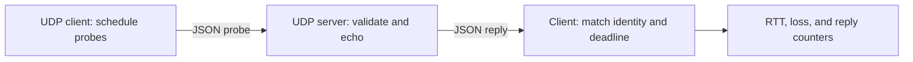

# socket-networking

A lightweight Python project exploring socket communication and application protocol design. The implemented UDP diagnostics tool measures round-trip latency and deadline-based packet loss. A TCP application is planned, not implemented.

## Technologies

Python 3.11+ and the standard library: `socket`, `select`, `time`, `json`, `argparse`, and `unittest`. No external dependencies.

## UDP diagnostics

- Configurable host, port, probe count, timeout, and send interval.
- Multiple probes in flight, each with its own deadline.
- Sequence numbers and per-run IDs to match replies.
- Monotonic timestamps for RTT; no clock synchronization required.
- Loss percentage and minimum, average, and maximum RTT.
- Tracking of late, duplicate, malformed, and out-of-order replies.

The server is a stateless reflector: it echoes valid probes and silently discards invalid datagrams. It does not simulate packet loss. Controlled loss and reordering are exercised by test peers.

## Run

From the `socket-networking` directory, start the server:

```sh
python -m udp.server --host 127.0.0.1 --port 9000
```

In another terminal:

```sh
python -m udp.client --host 127.0.0.1 --port 9000 --count 20 --timeout 0.5 --interval 0.1
```

Defaults: loopback host, port 9000, eight probes, one-second timeout, and 0.1 seconds between sends. Times are in seconds; `--interval 0` sends without intentional spacing. Counts range from 1 to 10,000. Use `--help` for options and Ctrl+C to stop.

For a trusted LAN, bind the server with `--host 0.0.0.0` and use its IPv4 address as the client's host. The tool is IPv4-only and provides no authentication or encryption; keep the reflector off the public Internet.

## Protocol

Each datagram contains one UTF-8 JSON object, at most 512 bytes:

```json
{"version":1,"kind":"probe","run":"0123456789abcdef0123456789abcdef","sequence":0,"sent_ns":1234567890}
```

| Field | Meaning |
| --- | --- |
| `version` | Integer `1` |
| `kind` | `probe` or `reply` |
| `run` | Random 32-character lowercase hexadecimal ID for one client run |
| `sequence` | Zero-based sequence number |
| `sent_ns` | Client monotonic timestamp in nanoseconds, echoed unchanged |

Sequence numbers and timestamps are integers from 0 through `2^63 - 1`. Missing, extra, or duplicate fields and unsupported values are rejected. Replies preserve all fields except `kind`, which becomes `reply`. The server never replies to a reply.

The client accepts packets only from the configured endpoint and matches the run, sequence, and timestamp. RTT is the local receive time minus the echoed timestamp. A reply arriving at or after its deadline counts as late; that probe remains lost. Out-of-order replies received before their own deadlines count as successes. Duplicates do not affect RTT or loss statistics.

Loss is `(sent - accepted replies) / sent`. It means no valid reply arrived before the deadline, not proof that a specific network packet was dropped. The run ends when every sent probe has succeeded or expired; packets arriving afterward are not counted. Socket errors produce a nonzero exit status; a completed measurement can report 100% loss and still exit successfully.



## Tests

```sh
python -m unittest discover -s tests -v
```

Tests cover protocol validation, deadline boundaries, RTT and loss calculations, duplicates, delayed and out-of-order replies, CLI errors, and real loopback UDP exchanges. No running server or external network is required.

## Planned TCP application

A multi-client chat application is planned to explore connection lifecycle management, message framing over byte streams, concurrent clients, and graceful disconnects. No TCP application code is implemented. See [the TCP plan](tcp/README.md).
